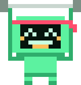

# Bit — maskotka PixGYM

Piksel-artowy robot z głową-monitorem (siatka 20×21). Rysowany jako SVG z prostokątów 1×1,
więc skaluje się bez rozmycia (`shape-rendering: crispEdges`). Składa się z części:
głowa, oczy, usta, tułów, akcesoria, dzięki czemu nowy nastrój to tylko inny zestaw pikseli.

## Wygląd

| idle | flex | lift | sleep |
|:---:|:---:|:---:|:---:|
|  |  |  |  |

**Zły Bit** (motyw „Red Team”: rogi zamiast anteny, wściekłe oczy, kły):

| evil | evil + flex |
|:---:|:---:|
|  |  |

**Akcesoria** (po jednym na miejsce: głowa, twarz, szyja):

| korona + okulary + łańcuch | słuchawki | opaska (flex) |
|:---:|:---:|:---:|
|  |  |  |

Pliki `bit-*.svg` obok tego pliku to gotowe, statyczne obrazki (kolory wpisane na sztywno, 160 px szerokości,
przezroczyste tło). Można ich użyć jako ikon, avatara albo grafiki w README.

## Paleta

| Znak | Rola | Zielony | Czerwony (evil) |
|---|---|---|---|
| `G` | korpus | `#5cf2a0` | `#ff3b5c` |
| `g` | cień korpusu | `#2fae6c` | `#b0102e` |
| `W` | oczy, usta | `#c8ffe0` | `#ffe14d` |
| `A` | antena, rumieńce, język | `#ffbe5c` | `#ffbe5c` |
| `K` | ekran | `#06140d` | `#06140d` |
| `M` / `m` | sztanga, hantel | `#7e8f86` / `#c9d6cf` | jw. |
| `R` `S` `w` `Y` `D` | akcesoria | `#ff4d6d` `#0b0b0b` `#ffffff` `#ffd23f` `#2b2f33` | jw. |

## Użycie (React)

Skopiuj `Bit.tsx` i `bit.css` do projektu (jedyna zależność to React).

```tsx
import { Bit, BitSays } from "./Bit";
import "./bit.css";

<Bit />                                       // idle, 64 px
<Bit mood="flex" size=120 />
<Bit mood="sleep" />
<Bit evil />                                  // zły Bit
<Bit gear={["crown", "shades", "chain"]} />
<BitSays mood="flex">Nowy rekord!</BitSays>
```

Kolory zmienisz zmiennymi CSS `--bit-body`, `--bit-shade`, `--bit-eye`, `--bit-amber` i `--bit-glow` (RGB poświaty),
np. na kontenerze albo w `:root`.

Bez Reacta: weź gotowy plik `bit-*.svg` albo przepisz `Bit()` na funkcję zwracającą string z `<rect>` (dane pikseli są
zwykłymi tablicami, niezależnymi od frameworka).

## Kod: `Bit.tsx`

```tsx
import type { ReactNode } from "react";

/**
 * Bit: maskotka PixGYM (wersja przenośna, bez zależności poza Reactem).
 * Piksel-art 20×21 składany z części (głowa, twarz, tułów), żeby każdy nastrój
 * nie wymagał rysowania całej postaci od nowa.
 *
 * Kolory: zmienne CSS --bit-body, --bit-shade, --bit-eye, --bit-amber (z domyślnymi wartościami),
 * więc w nowym projekcie wystarczy je nadpisać. `evil` = wersja „Red Team” (rogi, kły, czerwień).
 */

export type Mood = "idle" | "flex" | "sleep" | "lift";
export type GearId = "headband" | "headphones" | "crown" | "shades" | "chain";

const GREEN = { G: "#5cf2a0", g: "#2fae6c", W: "#c8ffe0" };
const RED = { G: "#ff3b5c", g: "#b0102e", W: "#ffe14d" };

function palette(evil: boolean): Record<string, string> {
  const t = evil ? RED : GREEN;
  return {
    G: `var(--bit-body, ${t.G})`,
    g: `var(--bit-shade, ${t.g})`,
    K: "#06140d",
    W: `var(--bit-eye, ${t.W})`,
    A: "var(--bit-amber, #ffbe5c)",
    M: "#7e8f86",
    m: "#c9d6cf",
    // akcesoria
    R: "#ff4d6d",
    S: "#0b0b0b",
    w: "#ffffff",
    Y: "#ffd23f",
    D: "#2b2f33",
  };
}

const W = 20;
const H = 21;

// Głowa-monitor 14×10, ekran (K) w kolumnach 2–11, wierszach 2–7.
const HEAD = [
  ".GGGGGGGGGGGG.",
  "GGGGGGGGGGGGGG",
  "GGKKKKKKKKKKGG",
  "GGKKKKKKKKKKGG",
  "GGKKKKKKKKKKGG",
  "GGKKKKKKKKKKGG",
  "GGKKKKKKKKKKGG",
  "GGKKKKKKKKKKGG",
  "GGGGGGGGGGGGGG",
  ".gggggggggggg.",
];
const HEAD_X = 3;
const HEAD_Y = 4;

type Px = readonly [x: number, y: number, c: string];

// Twarze we współrzędnych głowy.
const EYES_OPEN: Px[] = [3, 4, 9, 10].flatMap((x) => [[x, 3, "W"], [x, 4, "W"]] as Px[]);
const EYES_HAPPY: Px[] = [
  [3, 4, "W"], [4, 3, "W"], [5, 4, "W"],
  [8, 4, "W"], [9, 3, "W"], [10, 4, "W"],
];
const EYES_CLOSED: Px[] = [3, 4, 9, 10].map((x) => [x, 4, "W"] as Px);
const EYES_FOCUS: Px[] = [...EYES_CLOSED, [3, 3, "W"], [10, 3, "W"]];
const SMILE: Px[] = [[4, 6, "W"], [9, 6, "W"], [5, 7, "W"], [6, 7, "W"], [7, 7, "W"], [8, 7, "W"]];
const GRIN: Px[] = [4, 5, 6, 7, 8, 9].map((x) => [x, 6, "W"] as Px).concat([5, 6, 7, 8].map((x) => [x, 7, "A"] as Px));
const SNOOZE: Px[] = [[6, 7, "W"], [7, 7, "W"]];
const FLAT: Px[] = [5, 6, 7, 8].map((x) => [x, 7, "W"]);
const BLUSH: Px[] = [[2, 5, "A"], [11, 5, "A"]];

function rows(lines: string[]): Px[] {
  return lines.flatMap((line, y) => [...line].flatMap((c, x) => (c === "." ? [] : [[x, y, c] as Px])));
}

const ANTENNA: Px[] = [[9, 2, "A"], [10, 2, "A"], [9, 3, "g"], [10, 3, "g"]];

// Zły Bit (motyw czerwony): rogi zamiast anteny, wściekłe oczy, uśmiech z kłami.
const HORNS: Px[] = [[5, 3, "G"], [4, 3, "G"], [4, 2, "G"], [3, 1, "G"], [14, 3, "G"], [15, 3, "G"], [15, 2, "G"], [16, 1, "G"]];
const EYES_EVIL: Px[] = [[3, 3, "W"], [3, 4, "W"], [4, 4, "W"], [5, 4, "W"], [10, 3, "W"], [10, 4, "W"], [9, 4, "W"], [8, 4, "W"]];
const FANGS: Px[] = [3, 4, 5, 6, 7, 8, 9, 10].map((x) => [x, 6, "W"] as Px).concat([[4, 7, "W"], [9, 7, "W"]] as Px[]);
const isAntenna = ([x, y]: Px) => (x === 9 || x === 10) && (y === 2 || y === 3);

// Akcesoria (współrzędne całej postaci 20×21; głowa zaczyna się w (3, 4)).
export const GEAR_PX: Record<GearId, Px[]> = {
  headband: [...[3, 4, 5, 6, 7, 8, 9, 10, 11, 12, 13, 14, 15, 16].map((x) => [x, 5, "R"] as Px), [17, 5, "R"], [18, 6, "R"], [17, 6, "R"], [18, 7, "R"]],
  headphones: [
    ...[5, 6, 7, 8, 9, 10, 11, 12, 13, 14].map((x) => [x, 2, "D"] as Px),
    [4, 3, "D"], [15, 3, "D"], [3, 4, "D"], [16, 4, "D"],
    ...[6, 7, 8, 9].flatMap((y) => [[1, y, "D"], [2, y, "D"], [17, y, "D"], [18, y, "D"]] as Px[]),
    [1, 7, "R"], [18, 7, "R"],
  ],
  crown: [
    ...[6, 7, 8, 9, 10, 11, 12, 13].map((x) => [x, 3, "Y"] as Px),
    [6, 2, "Y"], [8, 2, "Y"], [9, 2, "R"], [10, 2, "R"], [11, 2, "Y"], [13, 2, "Y"],
    [6, 1, "Y"], [9, 1, "Y"], [10, 1, "Y"], [13, 1, "Y"],
  ],
  shades: [
    ...[5, 6, 7, 8, 11, 12, 13, 14].flatMap((x) => [[x, 7, "S"], [x, 8, "S"]] as Px[]),
    [9, 7, "S"], [10, 7, "S"], [6, 7, "w"], [12, 7, "w"],
  ],
  chain: [[7, 14, "Y"], [8, 15, "Y"], [9, 15, "Y"], [10, 15, "Y"], [11, 15, "Y"], [12, 14, "Y"], [9, 16, "Y"], [10, 16, "Y"]],
};

const BODY_IDLE = rows([
  ...Array<string>(14).fill(""),
  "......GGGGGGGG......",
  "....ggGGGGGGGGgg....",
  "....g.GGGGGGGG.g....",
  "....g.GGGGGGGG.g....",
  "......gggggggg......",
  "......GG....GG......",
  "......gg....gg......",
]);

// Ręce w górze ze sztangą nad głową.
const BODY_FLEX = rows([
  "MM................MM",
  "MMmmmmmmmmmmmmmmmmMM",
  "MMg..............gMM",
  "..g..............g..",
  "..g..............g..",
  "..g..............g..",
  "..g..............g..",
  "..g..............g..",
  "..g..............g..",
  "..g..............g..",
  "..g..............g..",
  "..g..............g..",
  "..g..............g..",
  "..g..............g..",
  "..ggggGGGGGGGGgggg..",
  "......GGGGGGGG......",
  "......GGGGGGGG......",
  "......GGGGGGGG......",
  "......gggggggg......",
  "......GG....GG......",
  "......gg....gg......",
]);

// Hantel w prawej ręce, opuszczony.
const BODY_LIFT = rows([
  ...Array<string>(14).fill(""),
  "......GGGGGGGG......",
  "....ggGGGGGGGGgg....",
  "....g.GGGGGGGG.g....",
  "....g.GGGGGGGG.gM.M.",
  "......gggggggg.mmmm.",
  "......GG....GG..M.M.",
  "......gg....gg......",
]);

const ZZZ = rows(["..............WWW...", "...............W....", "..............WWW..."]);

interface Parts {
  body: Px[];
  eyes: Px[];
  mouth: Px[];
  extra?: Px[];
  zzz?: boolean;
}

const MOODS: Record<Mood, Parts> = {
  idle: { body: [...ANTENNA, ...BODY_IDLE], eyes: EYES_OPEN, mouth: SMILE },
  flex: { body: BODY_FLEX, eyes: EYES_HAPPY, mouth: GRIN, extra: BLUSH },
  sleep: { body: [...ANTENNA, ...BODY_IDLE], eyes: EYES_CLOSED, mouth: SNOOZE, zzz: true },
  lift: { body: [...ANTENNA, ...BODY_LIFT], eyes: EYES_FOCUS, mouth: FLAT },
};

function Pixels({ px, pal, dx = 0, dy = 0, className }: { px: Px[]; pal: Record<string, string>; dx?: number; dy?: number; className?: string }) {
  return (
    <g className={className}>
      {px.map(([x, y, c], i) => (
        <rect key={i} x={x + dx} y={y + dy} width={1.02} height={1.02} fill={pal[c]} />
      ))}
    </g>
  );
}

export function Bit({
  mood = "idle",
  size = 64,
  className = "",
  evil = false,
  gear = [],
}: {
  mood?: Mood;
  size?: number;
  className?: string;
  evil?: boolean;
  /** Akcesoria, np. ["crown", "shades"]. Jedno na miejsce: głowa (headband/headphones/crown), twarz (shades), szyja (chain). */
  gear?: GearId[];
}) {
  const pal = palette(evil);
  const gearPx = gear.flatMap((id) => GEAR_PX[id]);
  const base = MOODS[mood];
  const hatted = gear.includes("crown") || gear.includes("headphones");
  const m0: Parts = evil
    ? {
        ...base,
        body: [...base.body.filter((p) => !isAntenna(p)), ...HORNS],
        eyes: mood === "sleep" ? base.eyes : EYES_EVIL,
        mouth: FANGS,
        extra: undefined,
      }
    : base;
  const m: Parts = hatted ? { ...m0, body: m0.body.filter((p) => !isAntenna(p)) } : m0;
  return (
    <svg
      viewBox={`0 0 ${W} ${H}`}
      width={size}
      height={(size * H) / W}
      shapeRendering="crispEdges"
      className={`bit bit-${mood} ${evil ? "bit-evil" : ""} ${className}`}
      role="img"
      aria-label={evil ? "Zły Bit" : "Bit"}
    >
      <Pixels pal={pal} px={m.body} />
      <Pixels pal={pal} px={rows(HEAD)} dx={HEAD_X} dy={HEAD_Y} />
      <Pixels pal={pal} px={m.eyes} dx={HEAD_X} dy={HEAD_Y} className="bit-eyes" />
      <Pixels pal={pal} px={m.mouth} dx={HEAD_X} dy={HEAD_Y} />
      {m.extra && <Pixels pal={pal} px={m.extra} dx={HEAD_X} dy={HEAD_Y} />}
      {m.zzz && <Pixels pal={pal} px={ZZZ} className="bit-z" />}
      {gearPx.length > 0 && <Pixels pal={pal} px={gearPx} />}
    </svg>
  );
}

/** Bit z dymkiem (klasy .bubble z bit.css). */
export function BitSays({ mood = "idle", children, size = 72 }: { mood?: Mood; children: ReactNode; size?: number }) {
  return (
    <div style={{ display: "flex", alignItems: "flex-end", gap: 8 }}>
      <Bit mood={mood} size={size} />
      <div className="bubble">{children}</div>
    </div>
  );
}
```

## Kod: `bit.css`

```css
/* Bit: kolory (nadpisz w swoim projekcie) i animacje: oddycha, mruga, cieszy się, śpi. */
:root {
  --bit-body: #5cf2a0;
  --bit-shade: #2fae6c;
  --bit-eye: #c8ffe0;
  --bit-amber: #ffbe5c;
  --bit-glow: 92 242 160; /* RGB poświaty */
}
.bit-evil {
  --bit-body: #ff3b5c;
  --bit-shade: #b0102e;
  --bit-eye: #ffe14d;
  --bit-glow: 255 59 92;
}

@keyframes bit-bob {
  50% {
    transform: translateY(-3%);
  }
}
@keyframes bit-blink {
  0%,
  92%,
  100% {
    transform: scaleY(1);
  }
  95% {
    transform: scaleY(0.15);
  }
}
@keyframes bit-jump {
  0%,
  100% {
    transform: translateY(0);
  }
  30% {
    transform: translateY(-9%);
  }
  50% {
    transform: translateY(0) scaleY(0.96);
  }
}
@keyframes bit-z {
  0% {
    opacity: 0;
    transform: translate(0, 10%);
  }
  40%,
  70% {
    opacity: 1;
  }
  100% {
    opacity: 0;
    transform: translate(6%, -6%);
  }
}
.bit {
  flex-shrink: 0;
  overflow: visible;
  filter: drop-shadow(0 6px 14px rgb(var(--bit-glow) / 0.25));
}
.bit-idle,
.bit-lift {
  animation: bit-bob 2.6s ease-in-out infinite;
}
.bit-flex {
  animation: bit-jump 1.1s ease-in-out infinite;
}
.bit-sleep {
  animation: bit-bob 4s ease-in-out infinite;
  filter: drop-shadow(0 6px 14px rgb(var(--bit-glow) / 0.12)) saturate(0.7);
}
.bit-eyes {
  transform-box: fill-box;
  transform-origin: center;
  animation: bit-blink 4.5s infinite;
}
.bit-z {
  animation: bit-z 2.4s ease-in-out infinite;
}

/* Zły Bit: co kilka sekund glitch (przesunięcie + rozszczepienie kolorów). */
@keyframes bit-glitch {
  0%,
  86%,
  100% {
    translate: 0 0;
    filter: drop-shadow(0 6px 14px rgb(var(--bit-glow) / 0.3));
  }
  87% {
    translate: -3px 1px;
    filter: drop-shadow(3px 0 0 #00e5ff) drop-shadow(-3px 0 0 var(--bit-body));
  }
  89% {
    translate: 4px -1px;
    filter: drop-shadow(-4px 0 0 #00e5ff) hue-rotate(40deg);
  }
  91% {
    translate: 0 0;
    filter: drop-shadow(2px 0 0 #00e5ff);
  }
}
.bit-evil {
  animation-name: bit-bob, bit-glitch;
  animation-duration: 2.6s, 4.7s;
  animation-timing-function: ease-in-out, steps(1);
  animation-iteration-count: infinite;
}
.bit-evil.bit-flex {
  animation-name: bit-jump, bit-glitch;
  animation-duration: 1.1s, 3.1s;
}

/* Dymek komiksowy wskazujący na Bita (po lewej, u dołu). */
.bubble {
  position: relative;
  flex: 1;
  min-width: 0;
  margin-bottom: 12px;
  padding: 10px 14px;
  border: 1px solid #26362e;
  border-radius: 16px;
  background: #121a16;
  color: #e4efe8;
  font-size: 15px;
  line-height: 1.35;
}
.bubble::before {
  content: "";
  position: absolute;
  left: -7px;
  bottom: 14px;
  width: 12px;
  height: 12px;
  background: inherit;
  border-left: inherit;
  border-bottom: inherit;
  transform: rotate(45deg);
}

@media (prefers-reduced-motion: reduce) {
  .bit,
  .bit-eyes,
  .bit-z {
    animation: none;
  }
}
```
